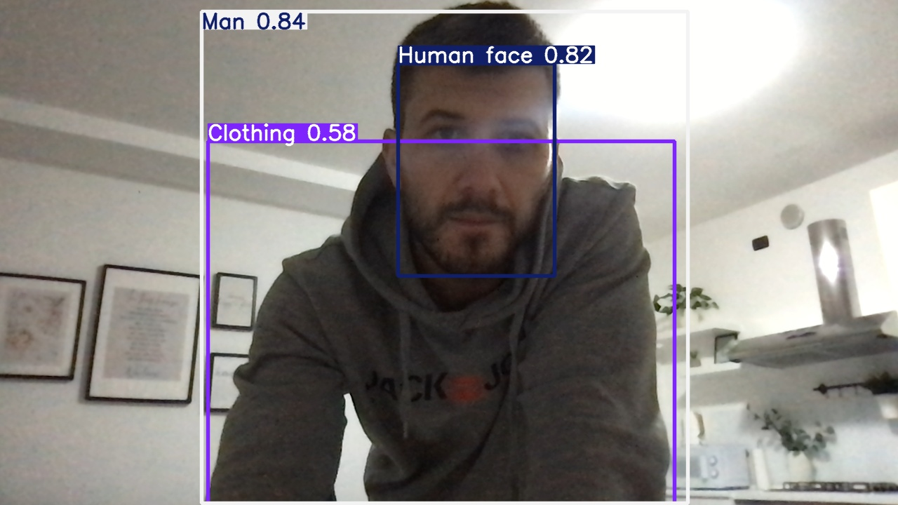

# SCAN AI | Orizon-AIx

**Real-time object detection desktop app built with PyQt5 and YOLOv8.**


## **Overview**

SCAN AI is a desktop application that runs YOLO models on a live webcam, an IP camera / RTSP stream, a video file or a still image. Detections are drawn on the video in real time and summarised in a side panel. The interface is available in **Italian and English** and has a dark and a light theme.

## **Features**

- Live detection from a local webcam, an IP camera / RTSP / HTTP URL, or a video file path
- Image analysis: pick an image from `assets/sample/` or browse to any image on disk
- Model selector: every `.pt` file in `models/` is listed automatically
- Adjustable confidence threshold (live, no restart needed)
- Live FPS counter, object counter and per-class detection summary
- Screenshot of the annotated frame and video recording (`.avi`), saved to `output/`
- Inference runs in a separate thread, so the UI stays responsive
- IT / EN interface switch, dark / light theme, "About" dialog

## **Screenshots**



<!-- TODO: add docs/screenshots/main-dark.png, main-light.png, info-dialog.png -->

## **Supported Models**

Any Ultralytics-compatible `.pt` model placed in `models/` works. Included / supported:

| Model | Task | Speed vs accuracy |
|---|---|---|
| `yolov8n.pt` | Detection | Fastest, lowest accuracy – good for webcams |
| `yolo11s-oiv7.pt` | Detection | Balanced, 600+ Open Images V7 classes |
| `yolov8s-seg.pt` | Segmentation | Medium speed, precise object shapes |
| `yolov8s-pose.pt` | Pose | Medium speed, human body keypoints |
| `yolov5x6u.pt` | Detection | Slow, high accuracy, detailed objects |
| `yolov8x.pt` | Detection | Slowest, highest accuracy, complex scenes |
| `best.pt`, `helmet.pt` | Custom | Custom-trained models (TODO: document classes and dataset) |

`yolov8x.pt` and `yolov5x6u.pt` are larger than GitHub's 100 MB file limit and are **not stored in the repository**. Download them with:

```bash
python scripts/download_models.py
```

## **Installation**

```bash
git clone https://github.com/<your-username>/scan-ai.git
cd scan-ai
python -m venv .venv
source .venv/bin/activate        # Windows: .venv\Scripts\activate
pip install -r requirements.txt
python scripts/download_models.py   # optional: large models
```

Tested with Python 3.10 (macOS).

## **Usage**

```bash
python main.py
```

`python app_pyqt.py` still works and starts the same app.

1. **Video source** – choose a local webcam, or "Other source" and enter an RTSP/HTTP URL or the path of a video file.
2. **YOLO model** – choose a model from the list.
3. **Confidence threshold** – move the slider; changes apply immediately.
4. Press **Start detection**. Use **Screenshot** and **Record video** while it runs; files are saved to `output/`.
5. **Image analysis** – pick an image (or press **Browse**) and press **Analyze**.
6. Switch language with the 🇮🇹 / 🇬🇧 buttons and theme with 🌙 / ☀️.

## **Build the .exe**

```bash
pip install -r requirements-dev.txt
python scripts/build_exe.py
```

The executable is created in `dist/`. Place the `models/` and `assets/` folders next to it. TODO: the PyInstaller build has not been tested yet.

## **Project Structure**

```
scan-ai/
├── main.py                  # entry point
├── app_pyqt.py              # compatibility launcher
├── src/scan_ai/
│   ├── ui/                  # main window, info dialog, styles/themes
│   ├── core/                # detection worker thread, camera discovery
│   ├── utils/               # paths and file helpers
│   └── i18n/                # IT / EN translations
├── models/                  # YOLO .pt weights
├── assets/sample/           # sample images
├── docs/screenshots/        # README screenshots
├── scripts/                 # build_exe.py, download_models.py
├── requirements.txt
├── requirements-dev.txt
└── LICENSE
```

## **Use Cases**

- **Industry and safety** – monitoring people and objects in work areas. Detecting helmets, vests or gloves requires a custom-trained model (see `helmet.pt` as an example).
- **Sports** – player and ball detection, or body pose analysis with the pose model.
- **Logistics** – counting and recognising packages, vehicles and pallets, ideally with a model trained on your own data.

## **Roadmap**

- [ ] Tested PyInstaller builds for Windows and macOS
- [ ] Document the custom models (classes, dataset, metrics)
- [ ] Model download from within the app
- [ ] Export detection results (CSV / JSON)
- [ ] More interface languages

## **Contributing**

Issues and pull requests are welcome. Please open an issue first to discuss larger changes.

## **License**

Released under the **GNU AGPL-3.0** license – see [LICENSE](LICENSE). Ultralytics YOLO is also AGPL-3.0 licensed.

## **Author**

**Arnel Kovacevic**
